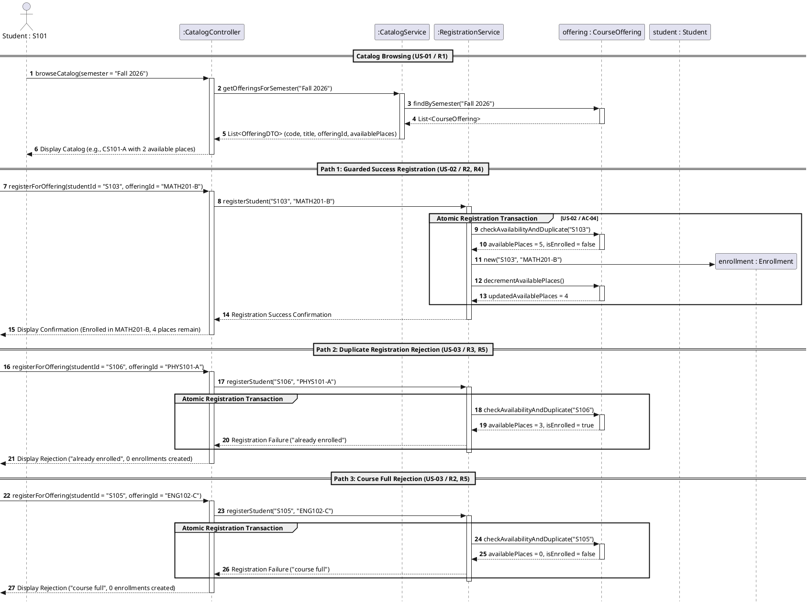
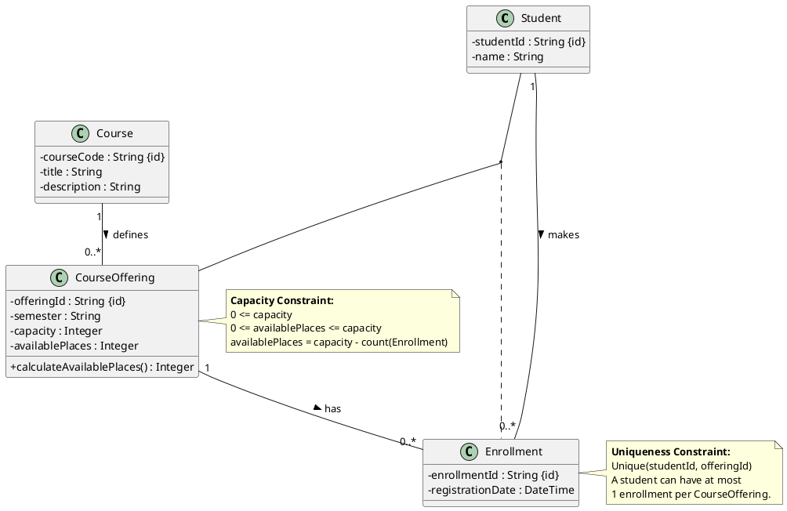
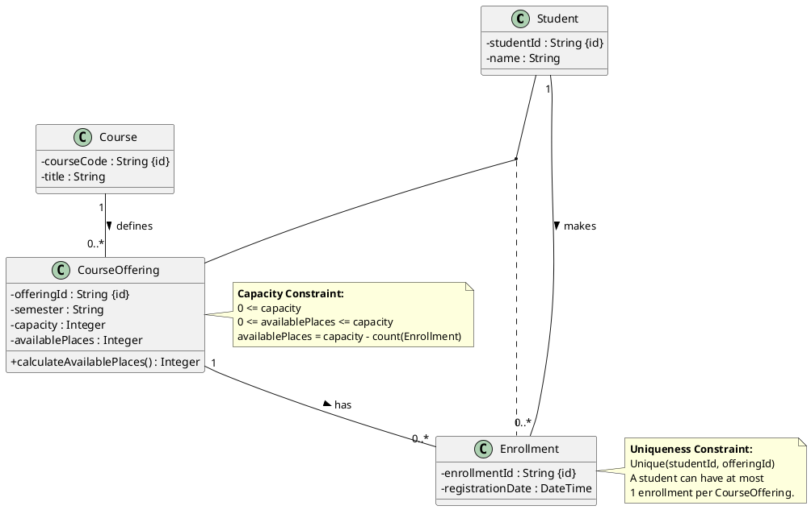
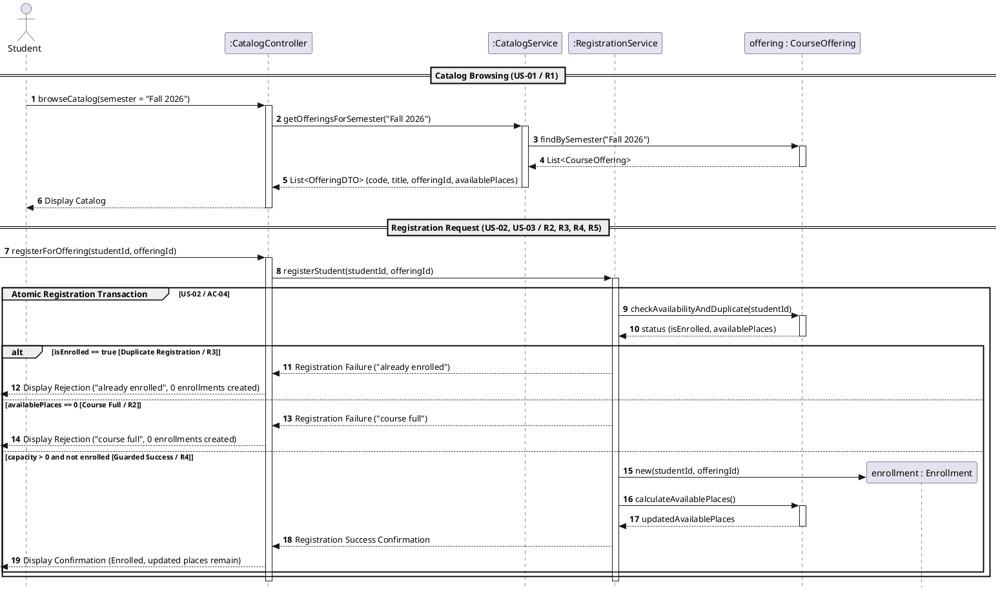

# SIS #02 — AI-Assisted UML Modeling: University Course Registration

<!--
  This is the only file you write your report in. README.md tells you what goes where.

  Rules the checker relies on:
  - Do not delete, rename or renumber the ## headings, the ### headings, or the **Label:** words.
  - Replace every "(write here)" and "(paste here)". None may be left when you submit.
  - Comments like this one are ignored by the checker and the word counter. Delete them or leave them.
-->

## 1. Scope and assumptions

<!-- Your FINAL scope statement and assumptions, after reviewing Prompt A's output. Say here
     what is out of scope (payments, prerequisites, timetable clashes, waiting lists,
     cancellation) — section 2 must not mention them. Section 10 keeps your first version. -->

**Scope:** This system provides a course registration workflow allowing signed-in students to browse an electronic catalog, view available places per course offering, and submit atomic registration requests that check capacity and duplicate enrollments. Payments, prerequisites, timetable clashes, waiting lists, and course cancellations are out of scope.

**Assumptions:**

1. The student is authenticated before browsing or requesting registration, and the system knows the student's identity.
2. Each `CourseOffering` exists for one semester and has a fixed positive whole-number capacity; available places are calculated from existing enrollments.
3. Final availability checks and Enrollment creation are treated as one atomic operation so competing requests cannot exceed capacity.

## 2. User stories and acceptance criteria

<!-- Your APPROVED requirements: Prompt A's draft after your review. Keep the IDs, the three
     story headings and the bullet shape. Every criterion names the rule(s) it maps to,
     e.g. (R2, R4). Two criteria per story. Nothing out of scope.
     Format of a criterion, on one bullet:
     - **AC-03** (R2, R4): Given ..., When ..., Then ... -->

### US-01 — Browse offerings

**US-01:** As a student, I want to browse the electronic course catalog for a specific semester, so that I can view course offerings and their available places.

- **AC-01** (R1): Given student S101 is signed in and browsing the catalog for Fall 2026, When S101 requests the course catalog for Fall 2026, Then the system displays each offering's course code, title, offering identifier, and current available places.
- **AC-02** (R1): Given offering CS101-A has capacity 30 and 28 existing enrollments, When S102 views the catalog for that semester, Then the system shows 2 available places for CS101-A.

### US-02 — Register for an offering

**US-02:** As a student, I want to register for a selected course offering, so that I can enroll in that specific scheduled section.

- **AC-03** (R2, R4): Given S103 is not enrolled in MATH201-B and it has 5 available places, When S103 requests registration, Then the system rechecks availability, creates exactly one Enrollment linking S103 to MATH201-B, updates available places to 4, and returns a confirmation.
- **AC-04** (R2, R4, R5): Given HIST101-A has exactly 1 available place, When two students submit registration requests for it at the same time, Then the system checks availability and creates Enrollment atomically, creates exactly one Enrollment, rejects the other request as "course full", and does not exceed capacity.

### US-03 — Receive a clear rejection

**US-03:** As a student, I want to receive a clear rejection reason when registration cannot be completed, so that I know why I was not enrolled.

- **AC-05** (R2, R5): Given ENG102-C has 0 available places and S105 is not enrolled in it, When S105 requests registration, Then the system rejects the request with "course full", creates no Enrollment, and leaves the enrollment count unchanged.
- **AC-06** (R3, R5): Given S106 is already enrolled in PHYS101-A and it has 3 available places, When S106 repeats the registration request, Then the system rejects it with "already enrolled", creates no additional Enrollment, and leaves the enrollment count unchanged.

## 3. Sequence diagram

<!-- The FINAL diagram, rendered. Change .png to .svg if that is what you exported. -->


**Participants:** `Student` is the signed-in user; `CatalogController` receives catalog and registration requests; `CatalogService` retrieves semester offerings; `RegistrationService` coordinates the atomic registration; `Offering` represents the selected `CourseOffering`; and `Enrollment` is the record created on success.

**Atomic operation:** The `Atomic registration operation` group contains `checkDuplicate`, `checkCurrentAvailability`, and, on the success branch only, `createEnrollment`. The checks and creation are treated as one indivisible operation so concurrent requests cannot take the same last place. Catalog browsing returns a snapshot and reserves no place; registration therefore rechecks current availability.

**Where the Enrollment is created:** The `RegistrationService` sends `createEnrollment(studentId, offeringId)` to the `Enrollment` lifeline. This creates the `Enrollment` class instance that links one `Student` to one `CourseOffering`.

**Technical lifelines:** `CatalogController`, `CatalogService`, and `RegistrationService` are application or boundary components rather than domain classes. Their presence in the sequence diagram explains request handling and coordination; the class diagram focuses on domain concepts.

## 4. Class diagram

<!-- The FINAL diagram, rendered. -->


<!-- One row per association in classes.puml, read in both directions. -->

| Association | Read left to right | Read right to left |
| --- | --- | --- |
| `Student` — `Enrollment` | One student may have zero or more enrollments. | Each enrollment belongs to exactly one student. |
| `CourseOffering` — `Enrollment` | One offering may receive zero or more enrollments. | Each enrollment targets exactly one offering. |
| `Course` — `CourseOffering` | One course has one or more scheduled offerings. | Each offering describes exactly one course. |

**How an Enrollment links a student to an offering:** Each `Enrollment` is associated with exactly one `Student` and exactly one `CourseOffering`; the two associations identify who registered for which scheduled section.

**Capacity constraint:** `capacity` is a positive whole number, and `/availablePlaces = capacity - count(Enrollment)` with available places between zero and capacity. Multiplicity describes relationships between objects, not a numeric limit on enrollment count.

**Uniqueness constraint:** `Unique(studentId, offeringId)` permits at most one enrollment for a given student and offering pair. Multiplicity alone cannot prevent duplicate pairs across separate Enrollment instances.

## 5. Traceability

<!-- Every rule, including the catalog fields and availability (R1). Column 1: the rule and
     the criteria that cover it, e.g. "R2 + AC-03, AC-04". Column 2: the message, guard,
     class or constraint that shows the rule in YOUR diagrams. Column 3: the T-ID that
     exercises it, or the extra check you did instead (R1 has no T case). -->

| Rule and criterion | Model evidence | Validation case |
| --- | --- | --- |
| R1 + AC-01, AC-02 | `browseCatalog`, `getOfferingsForSemester`, and catalog result fields: code, title, offeringId, availablePlaces. | Extra R1 check: inspect the catalog output fields and available-place value. |
| R2 + AC-03, AC-04, AC-05 | `checkCurrentAvailability`, the `course full` branch, capacity constraint, and atomic-operation note. | T2, T3. |
| R3 + AC-06 | `checkDuplicate`, the `already enrolled` branch, and `Unique(studentId, offeringId)`. | T4. |
| R4 + AC-03, AC-04 | Success branch `createEnrollment`, availability recalculation, confirmation, and the two Enrollment associations. | T1, T2. |
| R5 + AC-04, AC-05, AC-06 | Rejection branches return `course full` or `already enrolled`; neither branch creates an Enrollment. | T3, T4. |

## 6. Walkthroughs

<!-- Walk each case through YOUR final sequence diagram, message by message. Column 2: the
     actual steps and the state change (count before → after). Column 3 starts with Pass or
     Fail, then the location: the message, guard or note where you saw it. A Fail you
     report honestly is a finding, not a penalty. -->

| Case | Observed path and state change | Judgment and evidence |
| --- | --- | --- |
| T1. Available | The student browses the catalog (messages 1–6), which shows 2 available places for the example offering. They register (messages 7–8); the duplicate check returns false (messages 9–10), and the current availability check returns 2 (messages 11–12). The success branch creates one Enrollment (message 17), recalculates places (messages 18–19), and returns confirmation (messages 20–21). Enrollment count: 0 → 1; available places: 2 → 1. | Pass: the `not enrolled and places left` branch creates the Enrollment at message 17; message 19 returns recalculated availability and message 21 confirms registration. |
| T2. Last place | With capacity 2 and 1 existing Enrollment, the catalog shows 1 available place. The new student's request passes the duplicate check and the current availability check returns 1 (messages 9–12). The success branch creates one Enrollment and recalculates availability (messages 17–19). Enrollment count: 1 → 2; available places: 1 → 0. | Pass: the `not enrolled and places left` branch contains `createEnrollment` and the availability recalculation. The atomic-operation note states that the final checks and creation happen atomically; this T2 walkthrough follows the specified single request. |
| T3. Full | The catalog snapshot shows 1 place (messages 1–6), but it does not reserve it. Before registration, the current availability check returns 0 (messages 11–12). The `course full` branch returns the rejection reason (messages 15–16); the success branch and `createEnrollment` are not reached. Enrollment count: 2 → 2; current available places: 0 → 0. | Pass: the catalog snapshot note says viewing does not reserve a place; the `course full` branch returns the reason and creates no Enrollment. |
| T4. Duplicate | With capacity 2 and 1 existing Enrollment for this student and offering, 1 place remains. The repeat request reaches the duplicate check (messages 9–10); the `already enrolled` branch returns a rejection (messages 13–14). No Enrollment is created. Enrollment count: 1 → 1; available places: 1 → 1. | Pass: the `already enrolled` branch returns the rejection and states that no Enrollment is created. It is listed before `course full`, so the diagram gives duplicate rejection precedence if both conditions hold. |

## 7. Review decisions

<!-- At least three substantive decisions about Prompt C's critique or your own inspection.
     Decision: accepted / rejected / modified — and what you did. Reason: why, in a full
     sentence. Rule: R1–R5. Do not invent an error to fill the table; a justified rejection
     of advice counts. -->

<!-- At least three substantive decisions about Prompt C's critique or your own inspection.
     Decision: accepted / rejected / modified — and what you did. Reason: why, in a full
     sentence. Rule: R1–R5. Do not invent an error to fill the table; a justified rejection
     of advice counts. -->

| AI suggestion or model element | Decision | Reason | Rule |
| --- | --- | --- | --- |
| Remove redundant association class line `(Student, CourseOffering) .. Enrollment` from `classes.puml`. | Accepted | Combining association class syntax with explicit 1-to-many binary relationships creates structural duplication and visual rendering clutter in PlantUML. | R4 |
| Add explicit `alt/else` combined fragment with guards `[availablePlaces > 0 and isEnrolled == false]` in `sequence.puml`. | Accepted | Adding explicit guard conditions within an `alt` execution block clearly models how capacity and uniqueness constraints branch into success or rejection flows. | R2, R3, R5 |
| Remove unused `participant "student : Student"` from `sequence.puml`. | Accepted | The participant was declared in the diagram header but never engaged in any message exchanges, so removing it eliminates unnecessary diagram noise. | R4 |
| Change `availablePlaces` to a derived attribute `/availablePlaces` in `classes.puml`. | Modified | Instead of adding database locking logic, marking `availablePlaces` as a derived field (`/availablePlaces`) precisely indicates that available seats are calculated dynamically from capacity minus active enrollments. | R1, R2 |
## 8. Modeling explanation

<!-- 200–300 words. Your main design choices; how the class diagram and the sequence diagram
     complement each other; why an activity diagram could also help explain the workflow. -->

The class diagram captures the stable domain structure: a Course has one or more CourseOfferings, and each Enrollment connects exactly one Student to exactly one CourseOffering. The multiplicities describe how many related objects may exist, while the separate notes express rules that multiplicities cannot capture: capacity is a positive whole number, availability is derived from enrollment count, and the student-offering pair must be unique.

The sequence diagram shows the runtime behavior that the class diagram cannot show by itself. It begins with a catalog request and then shows a registration request. Because viewing the catalog does not reserve a place, RegistrationService checks for an existing enrollment and checks current availability again inside the atomic operation. The `alt` fragment separates duplicate rejection, full-course rejection, and successful registration. Only the success branch creates an Enrollment, recalculates available places, and returns confirmation; rejection branches explain the reason without creating a record. The controller and service lifelines represent application responsibilities, so they belong in the interaction diagram even though the domain class diagram focuses on Student, Course, CourseOffering, and Enrollment.

An activity diagram could complement these views by presenting the workflow as decisions and actions from the student's perspective. It could make the order of selection, final checks, success, and rejection easy to follow without emphasizing which component sends each message. It would be especially useful for explaining the branch conditions to a reader who is less familiar with sequence diagrams. The activity diagram would not replace the class diagram's structural constraints or the sequence diagram's message order and atomic boundary.

## 9. Reflection

<!-- 150–200 words. Written by you, not by the assistant: where AI helped, one decision you
     made yourself, one remaining limitation. Specific beats flattering. -->


AI significantly accelerated the initial setup phase by drafting structured User Stories and generating syntactically valid PlantUML boilerplate for both class and sequence diagrams. It provided a clean baseline for mapping the core domain entities (`Student`, `CourseOffering`, `Enrollment`) and functional rules R1–R5 into standard UML notation.

However, AI-generated models required careful human oversight to ensure architectural precision. One critical decision I made independently was modifying the AI’s critique regarding capacity tracking: instead of introducing unnecessary database transaction locking mechanisms to `CourseOffering`, I designated `availablePlaces` as a derived attribute (`/availablePlaces`). This accurately modeled dynamic calculation from capacity minus active enrollments without bloating the class structure.

A key remaining limitation of this system model is that static PlantUML sequence diagrams can only visually represent atomic execution through group blocks and logical `alt/else` guards. They cannot natively simulate or enforce thread-safe concurrency handling and database race condition prevention during simultaneous peak student requests without actual backend execution code.

## 10. Appendix A — Before AI

<!-- Written BEFORE you run Prompt A, committed and pushed in your first commit, and never
     edited afterwards. This is what you paste into Prompt A as "My initial assumptions". -->

**Scope:** This system provides a course registration workflow allowing signed-in students to browse an electronic catalog, view available places per course offering, and submit atomic registration requests that check capacity and duplicate enrollments while excluding payments, prerequisites, timetable clashes, waiting lists, and course cancellations.

**Initial assumptions:**

1. The student is already authenticated in the system, and their student identity is passed automatically with any registration request.
2. Each `CourseOffering` exists for a specific semester with a fixed positive integer capacity, and available places are calculated dynamically from existing enrollments.
3. The system executes availability rechecks and enrollment creation as a single atomic operation to ensure competing requests cannot cause over-enrollment.

## 11. Appendix B — AI exchanges

<!-- Complete prompts and complete responses, as text — never screenshots. Paste each inside
     the ~~~~ block that follows its label: AI responses contain ``` PlantUML blocks, and
     ~~~~ keeps them from breaking this file. Prompts B and C: the prompt text first, then
     the material it refers to ("below", "these two") pasted under it, in the same block.
     You may add B5, B6 … after B4 if you ran more. -->

### B1 — Requirements (Prompt A)

- **Tool:** Gemini AI
- **Model:** Gemini 3.6 Flash
- **Date:** 2026-10-18
- **Purpose:** draft 3 user stories and 6 acceptance criteria

<!-- Model: the exact model with its version, as the tool shows it (e.g. "GPT-5 Thinking",
     "Claude Sonnet 4.5"). If the tool does not show it, write: not displayed
     Date: YYYY-MM-DD -->

**Prompt:**

~~~~text
Act as a requirements analyst. Use only this course registration scenario and rules R1–R5: A student browses an electronic course catalog, chooses a course offering and requests registration. Each offering has a limited number of places. A Course describes a subject. A CourseOffering is one scheduled section in one semester. Registration always targets a specific offering. Assume that the student is signed in, the selected offering exists, and its capacity is a positive whole number. Exclude payments, prerequisites, timetable clashes, waiting lists and cancellation. Use fictional students and courses. Rules: R1. Catalog: Show the course code, title, offering and available places for one semester. R2. Capacity: Recheck current availability when registering. Enrollment must never exceed the offering's capacity. R3. Duplicates: A student may have at most one enrollment in the same offering. Reject a repeat request. R4. Success: Create exactly one Enrollment linking the student and offering, update availability and return a confirmation. R5. Rejection: Explain "course full" or "already enrolled". Create no enrollment and leave the enrollment count unchanged.. My initial assumptions are 1. The student is already authenticated in the system, and their student identity is passed automatically with any registration request. 2. Each CourseOffering exists for a specific semester with a fixed positive integer capacity, and available places are calculated dynamically from existing enrollments. 3. The system executes availability rechecks and enrollment creation as a single atomic operation to ensure competing requests cannot cause over-enrollment..
Draft 3 user stories and 2 Given / When / Then acceptance criteria for each. Use IDs US-01 to US-03 and AC-01 to AC-06. Map each criterion to rule IDs.
Cover normal and rejection behavior. List uncertainty separately. Do not add excluded features or invent university policies.
~~~~

**Response:**

~~~~text
## User Stories & Acceptance Criteria

### User Stories

* **US-01: Browse Available Course Offerings**
As an authenticated student, I want to browse the electronic course catalog for a specific semester, so that I can view available course offerings and their remaining places.
* **US-02: Register for a Course Offering**
As an authenticated student, I want to register for a selected course offering with available places, so that I can secure my enrollment in that specific section.
* **US-03: Handle Registration Failures**
As an authenticated student, I want to receive an explicit rejection reason when my registration cannot be processed, so that I know why I was not enrolled and the system state remains unchanged.

---

### Acceptance Criteria

#### US-01: Browse Available Course Offerings

* **AC-01: Display course catalog details**
* **Mapped Rules:** R1
* **Given** student "S101" is signed in and browsing the catalog for semester "Fall 2026",
* **When** "S101" requests the course catalog for "Fall 2026",
* **Then** the system displays each course offering with its course code (e.g., "CS101"), title (e.g., "Intro to Programming"), offering identifier (e.g., "Section A"), and current available places.


* **AC-02: Reflect dynamically calculated available places**
* **Mapped Rules:** R1, R2
* **Given** course offering "CS101-A" has a fixed capacity of 30 and 28 existing enrollments,
* **When** student "S102" views the catalog for that semester,
* **Then** the system shows exactly 2 available places for "CS101-A".


---

#### US-02: Register for a Course Offering

* **AC-03: Successful registration when capacity is available**
* **Mapped Rules:** R2, R4
* **Given** student "S103" is not enrolled in course offering "MATH201-B",
* **And** "MATH201-B" has 5 available places,
* **When** "S103" requests registration for "MATH201-B",
* **Then** the system rechecks availability, creates exactly one Enrollment linking "S103" to "MATH201-B", decrements the available places to 4, and returns a successful registration confirmation.


* **AC-04: Atomic concurrency handling for last available place**
* **Mapped Rules:** R2, R4
* **Given** course offering "HIST101-A" has exactly 1 available place remaining,
* **When** student "S104" submits a registration request for "HIST101-A",
* **Then** the system performs the availability check and enrollment creation atomically, enrolling "S104", updating available places to 0, and confirming the registration without exceeding capacity.


---

#### US-03: Handle Registration Failures

* **AC-05: Rejection due to full capacity**
* **Mapped Rules:** R2, R5
* **Given** course offering "ENG102-C" has 0 available places (enrollment count equals total capacity),
* **And** student "S105" is not enrolled in "ENG102-C",
* **When** "S105" submits a registration request for "ENG102-C",
* **Then** the system rejects the request with the explanation "course full", creates no enrollment, and leaves the enrollment count unchanged.


* **AC-06: Rejection due to duplicate registration request**
* **Mapped Rules:** R3, R5
* **Given** student "S106" already has an existing enrollment in course offering "PHYS101-A",
* **And** "PHYS101-A" has 3 available places,
* **When** "S106" submits a repeat registration request for "PHYS101-A",
* **Then** the system rejects the request with the explanation "already enrolled", creates no additional enrollment, and leaves the enrollment count unchanged.


---

### Identified Uncertainties

1. **Ordering of Checks on Simultaneous Failures:** If a student who is *already enrolled* requests registration for an offering that is *also full*, the scenario rules do not specify which rejection message ("course full" vs. "already enrolled") takes precedence.
2. **Catalog Filtering Scope:** Rule R1 specifies showing details "for one semester," but it is ambiguous whether the catalog defaults to the current active semester or if the user explicitly selects a target semester during browsing.
~~~~

### B2 — UML drafts (Prompt B)

- **Tool:** Gemini AI
- **Model:** Gemini 3.6 Flash
- **Date:** 2026-10-18
- **Purpose:** draft the sequence and class diagrams

**Prompt:**

~~~~text
Using my approved scenario, R1–R5, stories and criteria below, return separate PlantUML code blocks for a sequence diagram and a domain class diagram.
Sequence: include catalog browsing and guarded success, full-course and duplicate outcomes. Model final checks and creation as one atomic operation.
Class: show domain concepts, useful attributes and multiplicities. State the capacity and uniqueness constraints. Explain assumptions and any technical lifelines.

Approved scenario and rules:
A student browses an electronic course catalog, chooses a course offering and requests registration. Each offering has a limited number of places. A Course describes a subject. A CourseOffering is one scheduled section in one semester. Registration always targets a specific offering. Assume that the student is signed in, the selected offering exists, and its capacity is a positive whole number. Exclude payments, prerequisites, timetable clashes, waiting lists and cancellation. Use fictional students and courses.

R1. Catalog: Show the course code, title, offering and available places for one semester.
R2. Capacity: Recheck current availability when registering. Enrollment must never exceed the offering's capacity.
R3. Duplicates: A student may have at most one enrollment in the same offering. Reject a repeat request.
R4. Success: Create exactly one Enrollment linking the student and offering, update availability and return a confirmation.
R5. Rejection: Explain "course full" or "already enrolled". Create no enrollment and leave the enrollment count unchanged.

US-01 — Browse Available Course Offerings
As a student, I want to browse the electronic course catalog for a specific semester, so that I can view available course offerings and their remaining places.

- AC-01 (R1): Given student S101 is signed in and browsing the catalog for Fall 2026, When S101 requests the course catalog for Fall 2026, Then the system displays each course offering with its course code, title, offering identifier and current available places.
- AC-02 (R1): Given course offering CS101-A has a fixed capacity of 30 and 28 existing enrollments, When student S102 views the catalog for that semester, Then the system shows exactly 2 available places for CS101-A.

US-02 — Register for a Course Offering
As a student, I want to register for a selected course offering, so that I can enroll in that specific section.

- AC-03 (R2, R4): Given student S103 is not enrolled in MATH201-B and it has 5 available places, When S103 requests registration for MATH201-B, Then the system rechecks availability, creates exactly one Enrollment linking S103 to MATH201-B, updates available places to 4 and returns a confirmation.
- AC-04 (R2, R4, R5): Given HIST101-A has exactly 1 available place, When two students submit registration requests for HIST101-A at the same time, Then the system performs the final availability check and enrollment creation atomically, creates exactly one Enrollment, rejects the other request as "course full", and does not exceed capacity.

US-03 — Handle Registration Failures
As a student, I want to receive a clear rejection reason when my registration cannot be processed, so that I know why I was not enrolled.

- AC-05 (R2, R5): Given ENG102-C has 0 available places and S105 is not enrolled in it, When S105 requests registration for ENG102-C, Then the system rejects the request with "course full", creates no Enrollment and leaves the enrollment count unchanged.
- AC-06 (R3, R5): Given S106 is already enrolled in PHYS101-A and it has 3 available places, When S106 submits a repeat registration request for PHYS101-A, Then the system rejects the request with "already enrolled", creates no additional Enrollment and leaves the enrollment count unchanged.
~~~~

**Response:**

~~~~text
Below are the PlantUML sequence diagram and domain class diagram based on your approved scenario, requirements (R1–R5), and acceptance criteria.

---

## 1. Sequence Diagram

This sequence diagram illustrates the student browsing the course catalog followed by three distinct registration execution paths:

1. **Guarded Success Path** (MATH201-B for S103)
2. **Duplicate Registration Failure Path** (PHYS101-A for S106)
3. **Course Full Failure Path** (ENG102-C for S105)

An `atomic` group is used for the critical registration phase to model the final checks and enrollment creation as a single indivisible operation.



---

## 2. Domain Class Diagram



---

## 3. Constraints, Assumptions & Technical Explanation

### Capacity and Uniqueness Constraints

* **Capacity Constraint:** For every `CourseOffering`, $0 \le \text{availablePlaces} \le \text{capacity}$. `capacity` is set as a positive whole number ($> 0$). Current available places are dynamically rechecked as:

$$\text{availablePlaces} = \text{capacity} - \text{count}(\text{Enrollments})$$


* **Uniqueness Constraint:** The pair `(studentId, offeringId)` across all `Enrollment` records must be strictly unique. This guarantees a student can hold at most **1 enrollment** in the same scheduled `CourseOffering` (R3).

### Key Assumptions

1. **Pre-authenticated Session:** The student is already authenticated (`studentId` is known) before interacting with the system.
2. **Entity Existence:** Selected courses and offerings exist in the system database.
3. **Out of Scope:** Prerequisites, time conflicts, payment collection, waitlisting, and cancellations are excluded per the approved scenario.

### Technical Lifelines Explained

* **`CatalogController`:** Serves as the API endpoint/boundary layer handling incoming user interactions and presentation mapping (DTO formatting).
* **`CatalogService`:** Application service responsible for reading and assembling catalog data (`OfferingDTO`) containing course metadata and real-time available places.
* **`RegistrationService`:** Application service managing the transactional boundary for registration requests.
* **`Atomic Group` (`group Atomic Registration Transaction`):** Represents an isolated, concurrent-safe transaction boundary (e.g., via database locks or synchronized blocks). It prevents race conditions during simultaneous requests (e.g., AC-04) by enforcing that checking availability/duplicate status and writing the new `Enrollment` record happen atomically.
~~~~

### B3 — Model critique (Prompt C)

- **Tool:** Gemini AI
- **Model:** Gemini 3.6 Flash
- **Date:** 2026-10-18
- **Purpose:** review both models against R1–R5 and T1–T4

**Prompt:**

~~~~text
**Prompt C — model critique** → §11, B3. Under the prompt text, paste both original PlantUML
blocks and your acceptance criteria. **Use a new chat** — an assistant critiquing its own draft
in the same conversation tends to defend it.

```text
Review these two UML models against R1–R5 and my acceptance criteria. Check message order, guards, state changes, multiplicities and naming.
Inspect the four validation cases: available places, exactly one place, full course after a stale catalog view, and duplicate registration.
For each issue, cite the affected rule and model element. Explain the impact and propose a focused correction. Separate genuine defects from optional design choices.
```

**The critique is another claim to evaluate, not a verdict.** Accept, reject or modify each point
yourself, and record the substantive ones in section 7.

classes.puml
@startuml
skinparam classAttributeIconSize 0

class Student {
  - studentId : String {id}
  - name : String
}

class Course {
  - courseCode : String {id}
  - title : String
  - description : String
}

class CourseOffering {
  - offeringId : String {id}
  - semester : String
  - capacity : Integer
  - availablePlaces : Integer
  + calculateAvailablePlaces() : Integer
}

class Enrollment {
  - enrollmentId : String {id}
  - registrationDate : DateTime
}

' Relationships & Multiplicities
Student "1" -- "0..*" Enrollment : makes >
CourseOffering "1" -- "0..*" Enrollment : has >
Course "1" -- "0..*" CourseOffering : defines >

' Association Class Alternative View / Explicit Linking
(Student, CourseOffering) .. Enrollment

note right of CourseOffering
  <b>Capacity Constraint:</b>
  0 <= capacity
  0 <= availablePlaces <= capacity
  availablePlaces = capacity - count(Enrollment)
end note

note right of Enrollment
  <b>Uniqueness Constraint:</b>
  Unique(studentId, offeringId)
  A student can have at most 
  1 enrollment per CourseOffering.
end note

@enduml


sequence.puml:
@startuml
autonumber
skinparam Style strictuml
skinparam SequenceGroupBodyBackgroundColor transparent

actor "Student : S101" as Student
participant ":CatalogController" as Controller
participant ":CatalogService" as CatalogSvc
participant ":RegistrationService" as RegSvc
participant "offering : CourseOffering" as Offering
participant "student : Student" as StudentEntity
participant "enrollment : Enrollment" as Enrollment

== Catalog Browsing (US-01 / R1) ==

Student -> Controller : browseCatalog(semester = "Fall 2026")
activate Controller

Controller -> CatalogSvc : getOfferingsForSemester("Fall 2026")
activate CatalogSvc

CatalogSvc -> Offering : findBySemester("Fall 2026")
activate Offering
Offering --> CatalogSvc : List<CourseOffering>
deactivate Offering

CatalogSvc --> Controller : List<OfferingDTO> (code, title, offeringId, availablePlaces)
deactivate CatalogSvc

Controller --> Student : Display Catalog (e.g., CS101-A with 2 available places)
deactivate Controller

== Path 1: Guarded Success Registration (US-02 / R2, R4) ==

[-> Controller : registerForOffering(studentId = "S103", offeringId = "MATH201-B")
activate Controller

Controller -> RegSvc : registerStudent("S103", "MATH201-B")
activate RegSvc

group Atomic Registration Transaction [US-02 / AC-04]
    RegSvc -> Offering : checkAvailabilityAndDuplicate("S103")
    activate Offering
    Offering --> RegSvc : availablePlaces = 5, isEnrolled = false
    deactivate Offering

    create Enrollment
    RegSvc -> Enrollment : new("S103", "MATH201-B")
    
    RegSvc -> Offering : decrementAvailablePlaces()
    activate Offering
    Offering --> RegSvc : updatedAvailablePlaces = 4
    deactivate Offering
end

RegSvc --> Controller : Registration Success Confirmation
deactivate RegSvc

Controller -->[ : Display Confirmation (Enrolled in MATH201-B, 4 places remain)
deactivate Controller

== Path 2: Duplicate Registration Rejection (US-03 / R3, R5) ==

[-> Controller : registerForOffering(studentId = "S106", offeringId = "PHYS101-A")
activate Controller

Controller -> RegSvc : registerStudent("S106", "PHYS101-A")
activate RegSvc

group Atomic Registration Transaction
    RegSvc -> Offering : checkAvailabilityAndDuplicate("S106")
    activate Offering
    Offering --> RegSvc : availablePlaces = 3, isEnrolled = true
    deactivate Offering

    RegSvc --> Controller : Registration Failure ("already enrolled")
end
deactivate RegSvc

Controller -->[ : Display Rejection ("already enrolled", 0 enrollments created)
deactivate Controller

== Path 3: Course Full Rejection (US-03 / R2, R5) ==

[-> Controller : registerForOffering(studentId = "S105", offeringId = "ENG102-C")
activate Controller

Controller -> RegSvc : registerStudent("S105", "ENG102-C")
activate RegSvc

group Atomic Registration Transaction
    RegSvc -> Offering : checkAvailabilityAndDuplicate("S105")
    activate Offering
    Offering --> RegSvc : availablePlaces = 0, isEnrolled = false
    deactivate Offering

    RegSvc --> Controller : Registration Failure ("course full")
end
deactivate RegSvc

Controller -->[ : Display Rejection ("course full", 0 enrollments created)
deactivate Controller

@enduml
~~~~

**Response:**

~~~~text
### Prompt C — Model Critique

Review these two UML models against R1–R5 and my acceptance criteria. Check message order, guards, state changes, multiplicities and naming. Inspect the four validation cases: available places, exactly one place, full course after a stale catalog view, and duplicate registration. For each issue, cite the affected rule and model element. Explain the impact and propose a focused correction. Separate genuine defects from optional design choices.

---

### Original PlantUML Source Blocks

#### `classes.puml`



#### `sequence.puml`


---

### System Acceptance Criteria

| ID | Category | Requirement / Criterion Text |
| --- | --- | --- |
| **R1** | **Catalog Browsing** | System must display course code, title, offering ID, total capacity, and real-time available places for a requested semester. |
| **R2** | **Capacity Guard** | A student can register for a course offering if and only if `availablePlaces > 0`. |
| **R3** | **Uniqueness Guard** | A student cannot register for the same course offering more than once (`Unique(studentId, offeringId)`). |
| **R4** | **State Update** | Upon successful registration, an `Enrollment` instance must be created and `availablePlaces` must decrement by exactly 1 atomically. |
| **R5** | **Failure Handling** | On registration rejection (full course or duplicate enrollment), no `Enrollment` instance shall be created, `availablePlaces` must remain unchanged, and an informative message must be returned. |

---

### Model Analysis & Defect Critique

#### 1. Class Diagram (`classes.puml`)

* **Redundant Modeling Notation (Genuine Defect):**
* *Affected Element:* `(Student, CourseOffering) .. Enrollment` alongside explicit binary associations `Student "1" -- "0..* Enrollment"` and `CourseOffering "1" -- "0..* Enrollment"`.
* *Impact:* Rendering both explicit binary associations and an association class line `(A, B) .. C` on the same diagram creates structural ambiguity regarding whether `Enrollment` is an independent domain entity or a dependent association link.
* *Correction:* Remove `(Student, CourseOffering) .. Enrollment` and retain explicit binary 1-to-many associations to standard domain entities.


* **Missing Fields for Real-Time Validation (Design Improvement):**
* *Affected Element:* `CourseOffering` attributes.
* *Impact:* In a highly concurrent environment, maintaining a stored `availablePlaces` field alongside a dynamic `calculateAvailablePlaces()` call without explicit locking rules can introduce race conditions.
* *Correction:* Clarify in constraints whether `availablePlaces` is a derived attribute (`/availablePlaces`) or an persisted state field updated under row-level transaction locks.


#### 2. Sequence Diagram (`sequence.puml`)

* **Rule Violation: Omission of Explicit Guard Conditions on Messages (Genuine Defect):**
* *Affected Element:* Path 1 (`create Enrollment` and `decrementAvailablePlaces()`).
* *Impact / Rule Citation:* Violates **R2** and **R3**. Creation of the `Enrollment` entity happens sequentially after `checkAvailabilityAndDuplicate(...)` without an explicit guard notation `[availablePlaces > 0 AND isEnrolled == false]` on the message branch or inside a `alt` execution fragment.
* *Correction:* Wrap the instantiation and decrement logic in an `alt` fragment guarded by `[availablePlaces > 0 and isEnrolled == false]`, placing rejection paths in `else` branches.


* **Unused Participant (Design Flaw):**
* *Affected Element:* `participant "student : Student" as StudentEntity`.
* *Impact:* Declared in the header but never receives or sends any messages throughout any of the three sequence paths.
* *Correction:* Remove the unused `StudentEntity` participant or include explicit retrieval calls (e.g., `findByStudentId(studentId)`).


* **Stale Catalog View Handling (Validation Case Coverage):**
* *Affected Element:* Path 3 (Course Full Rejection).
* *Impact / Rule Citation:* Addresses **R2** and **R5**. Correctly demonstrates that even if a student browsed a catalog displaying available places, the atomic check `checkAvailabilityAndDuplicate(...)` detects `availablePlaces = 0` at transaction time and aborts without instantiating `Enrollment`.
~~~~

### B4 — Focused revision (Prompt D)

- **Tool:** Gemini AI
- **Model:** Gemini 3.6 Flash
- **Date:** 2026-10-18
- **Purpose:** apply my accepted review decisions

**Prompt:**

~~~~text
Revise the UML sources using only my accepted review decisions:
1. Remove the redundant association line `(Student, CourseOffering) .. Enrollment` from the class diagram and retain the explicit associations from Student to Enrollment and CourseOffering to Enrollment.
2. Add an `alt/else` combined fragment to the sequence diagram with guarded success, full-course and duplicate outcomes. Perform the final duplicate and capacity checks before creating Enrollment, inside one atomic operation. Create Enrollment and return confirmation only in the success branch. Rejection branches return their reason and make no state change.
3. Remove the unused `student : Student` participant from the sequence diagram.
4. Mark `availablePlaces` as a derived attribute `/availablePlaces`, calculated as capacity minus the enrollment count. After successful Enrollment creation, show that availability is recalculated; do not model it as a separately stored field that is decremented.

Keep justified existing elements and explain each change.
Preserve the agreed scope and rule IDs. Return both updated PlantUML blocks and a concise change log. Flag any unresolved issue.

Approved requirements:
Scenario: A student browses an electronic course catalog, chooses a course offering and requests registration. Each offering has a limited number of places. A Course describes a subject. A CourseOffering is one scheduled section in one semester. Registration always targets a specific offering. Assume that the student is signed in, the selected offering exists, and its capacity is a positive whole number. Exclude payments, prerequisites, timetable clashes, waiting lists and cancellation. Use fictional students and courses.

R1. Catalog: Show the course code, title, offering and available places for one semester.
R2. Capacity: Recheck current availability when registering. Enrollment must never exceed the offering's capacity.
R3. Duplicates: A student may have at most one enrollment in the same offering. Reject a repeat request.
R4. Success: Create exactly one Enrollment linking the student and offering, update availability and return a confirmation.
R5. Rejection: Explain "course full" or "already enrolled". Create no enrollment and leave the enrollment count unchanged.

US-01 — Browse Available Course Offerings
As a student, I want to browse the electronic course catalog for a specific semester, so that I can view available course offerings and their remaining places.
- AC-01 (R1): Given student S101 is signed in and browsing the catalog for Fall 2026, When S101 requests the course catalog for Fall 2026, Then the system displays each course offering with its course code, title, offering identifier and current available places.
- AC-02 (R1): Given course offering CS101-A has a fixed capacity of 30 and 28 existing enrollments, When student S102 views the catalog for that semester, Then the system shows exactly 2 available places for CS101-A.

US-02 — Register for a Course Offering
As a student, I want to register for a selected course offering, so that I can enroll in that specific section.
- AC-03 (R2, R4): Given student S103 is not enrolled in MATH201-B and it has 5 available places, When S103 requests registration for MATH201-B, Then the system rechecks availability, creates exactly one Enrollment linking S103 to MATH201-B, updates available places to 4 and returns a confirmation.
- AC-04 (R2, R4, R5): Given HIST101-A has exactly 1 available place, When two students submit registration requests for HIST101-A at the same time, Then the system performs the final availability check and enrollment creation atomically, creates exactly one Enrollment, rejects the other request as "course full", and does not exceed capacity.

US-03 — Handle Registration Failures
As a student, I want to receive a clear rejection reason when my registration cannot be processed, so that I know why I was not enrolled.
- AC-05 (R2, R5): Given ENG102-C has 0 available places and S105 is not enrolled in it, When S105 requests registration for ENG102-C, Then the system rejects the request with "course full", creates no Enrollment and leaves the enrollment count unchanged.
- AC-06 (R3, R5): Given S106 is already enrolled in PHYS101-A and it has 3 available places, When S106 submits a repeat registration request for PHYS101-A, Then the system rejects the request with "already enrolled", creates no additional Enrollment and leaves the enrollment count unchanged.

Original sources:

classes.puml:


### Updated `sequence.puml`



*(Note: There are no unresolved issues remaining. All requested UML updates have been applied cleanly according to the approved review decisions.)*
~~~~

## 12. Appendix C — Original diagrams

<!-- The AI's first output from Prompt B, rendered unedited from models/original/. -->


## 13. Appendix D — References and source checks

### References

<!-- Full references, one per line, each starting with "- ". Only sources you actually opened.
     Every URL used in the source checks must also appear here. Example:
     - Sommerville, I. (2016). Software Engineering, 10th ed., Global Edition. Pearson. Ch. 5. -->

- PlantUML. “Class Diagram syntax and features,” section “Label on relations.” https://plantuml.com/class-diagram (accessed 2026-10-18).
- PlantUML. “Sequence Diagram syntax and features,” section “Grouping message.” https://plantuml.com/sequence-diagram (accessed 2026-10-18).

### Source checks

<!-- At least two modeling decisions you verified. Source and locator: title + slide, page,
     section, chapter or figure — or title + URL + access date (YYYY-MM-DD). Slide numbers
     refer to the decks posted in our Teams. -->

| Modeling decision | Source and locator | What the source says | How it supports or changed your model |
| --- | --- | --- | --- |
| Multiplicities on associations | PlantUML Class Diagram documentation, “Label on relations,” https://plantuml.com/class-diagram (accessed 2026-10-18). | The documentation states that cardinality can be written in double quotes on each side of a relation. | This confirms the quoted multiplicity syntax used on all three class associations; the specific cardinality values come from the assignment's domain rules. |
| Alternative registration outcomes | PlantUML Sequence Diagram documentation, “Grouping message,” https://plantuml.com/sequence-diagram (accessed 2026-10-18). | The documentation lists `alt/else` as message grouping keywords and says `end` closes the group. | This confirms the syntax used to separate duplicate, full-course, and success paths; the branch conditions and outcomes follow R2–R5. |
