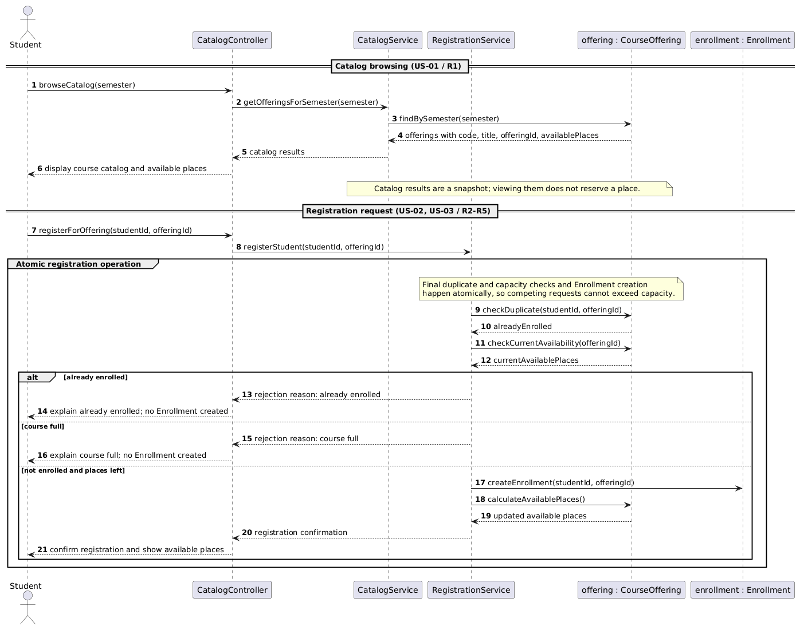
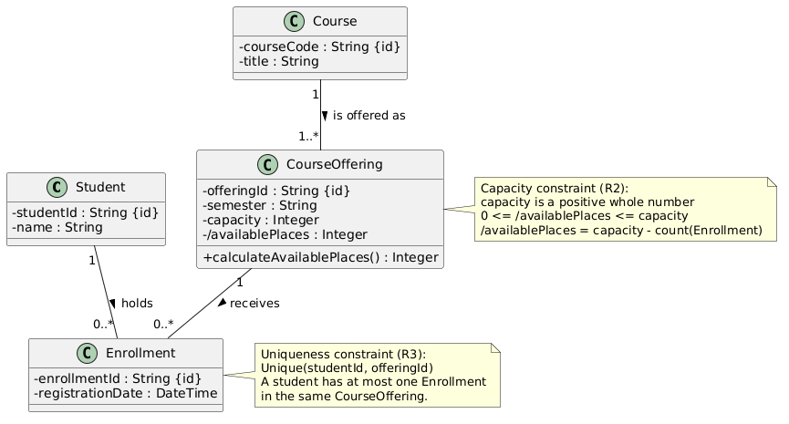
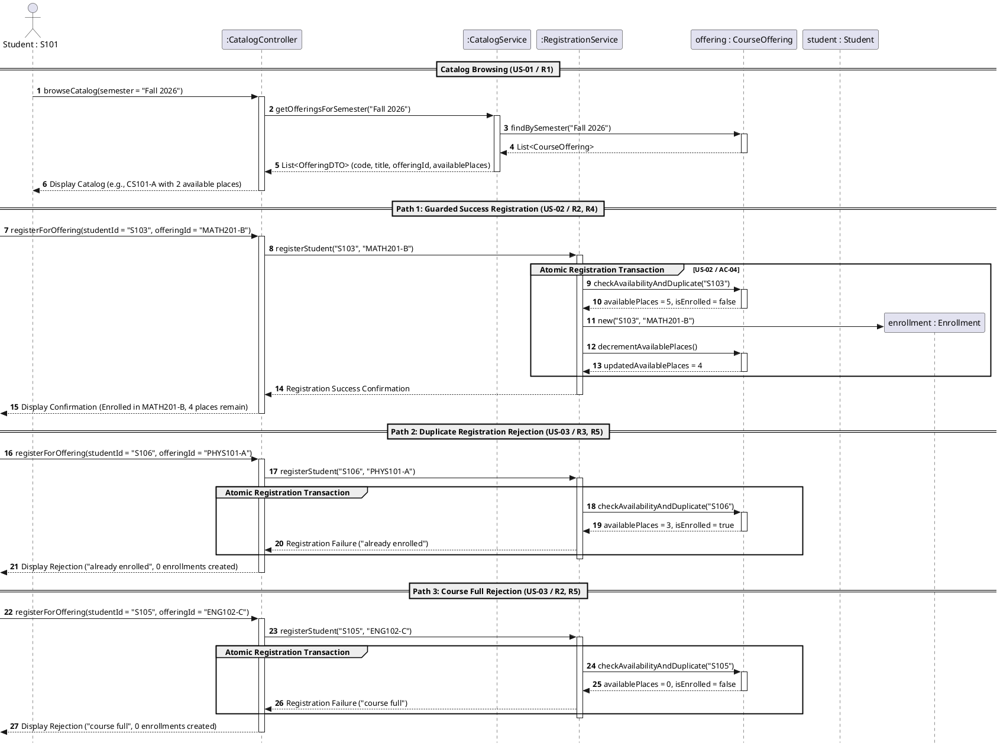
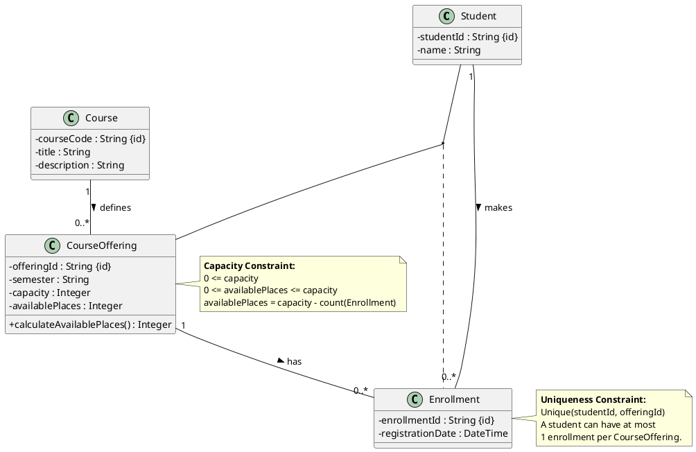
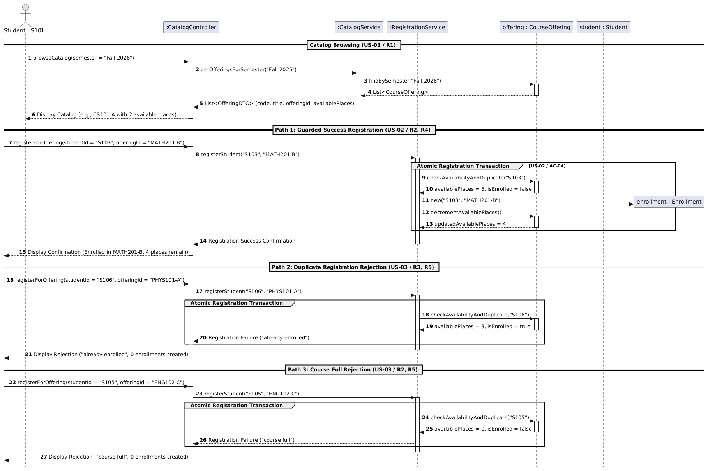

# SIS #02 — AI-Assisted UML Modeling: University Course Registration

<!--
  This is the only file you write your report in. README.md tells you what goes where.

  Rules the checker relies on:
  - Do not delete, rename or renumber the ## headings, the ### headings, or the **Label:** words.
  - Replace every "(write here)" and "(paste here)". None may be left when you submit.
  - Comments like this one are ignored by the checker and the word counter. Delete them or leave them.
-->

## 1. Scope and assumptions

<!-- Your FINAL scope statement and assumptions, after reviewing Prompt A's output. Say here
     what is out of scope (payments, prerequisites, timetable clashes, waiting lists,
     cancellation) — section 2 must not mention them. Section 10 keeps your first version. -->

**Scope:** (write here)

**Assumptions:**

1. (write here)
2. (write here)

## 2. User stories and acceptance criteria

<!-- Your APPROVED requirements: Prompt A's draft after your review. Keep the IDs, the three
     story headings and the bullet shape. Every criterion names the rule(s) it maps to,
     e.g. (R2, R4). Two criteria per story. Nothing out of scope.
     Format of a criterion, on one bullet:
     - **AC-03** (R2, R4): Given ..., When ..., Then ... -->

### US-01 — Browse offerings

**US-01:** (write here — As a student, I want …, so that …)

- **AC-01** (R?): (write here — Given …, When …, Then …)
- **AC-02** (R?): (write here)

### US-02 — Register for an offering

**US-02:** (write here)

- **AC-03** (R?): (write here)
- **AC-04** (R?): (write here)

### US-03 — Receive a clear rejection

**US-03:** (write here)

- **AC-05** (R?): (write here)
- **AC-06** (R?): (write here)

## 3. Sequence diagram

<!-- The FINAL diagram, rendered. Change .png to .svg if that is what you exported. -->



**Participants:** (write here — each lifeline and what it stands for)

**Atomic operation:** (write here — which messages form the one atomic step: the final duplicate check, the capacity check and the creation of the Enrollment, and why a catalog view reserves nothing)

**Where the Enrollment is created:** (write here — which message, which lifeline, and which class in section 4 it produces)

**Technical lifelines:** (write here — every lifeline that is NOT a class in the class diagram, by name, and why the difference in abstraction is fine. "None" if there are none.)

## 4. Class diagram

<!-- The FINAL diagram, rendered. -->



<!-- One row per association in classes.puml, read in both directions. -->

| Association | Read left to right | Read right to left |
| --- | --- | --- |
| (write here) | (write here) | (write here) |
| (write here) | (write here) | (write here) |
| (write here) | (write here) | (write here) |

**How an Enrollment links a student to an offering:** (write here)

**Capacity constraint:** (write here — and why multiplicity alone cannot express it)

**Uniqueness constraint:** (write here — and why multiplicity alone cannot express it)

## 5. Traceability

<!-- Every rule, including the catalog fields and availability (R1). Column 1: the rule and
     the criteria that cover it, e.g. "R2 + AC-03, AC-04". Column 2: the message, guard,
     class or constraint that shows the rule in YOUR diagrams. Column 3: the T-ID that
     exercises it, or the extra check you did instead (R1 has no T case). -->

| Rule and criterion | Model evidence | Validation case |
| --- | --- | --- |
| R1 + (write here) | (write here) | (write here) |
| R2 + (write here) | (write here) | (write here) |
| R3 + (write here) | (write here) | (write here) |
| R4 + (write here) | (write here) | (write here) |
| R5 + (write here) | (write here) | (write here) |

## 6. Walkthroughs

<!-- Walk each case through YOUR final sequence diagram, message by message. Column 2: the
     actual steps and the state change (count before → after). Column 3 starts with Pass or
     Fail, then the location: the message, guard or note where you saw it. A Fail you
     report honestly is a finding, not a penalty. -->

| Case | Observed path and state change | Judgment and evidence |
| --- | --- | --- |
| T1. Available | (write here) | (write here) |
| T2. Last place | (write here) | (write here) |
| T3. Full | (write here) | (write here) |
| T4. Duplicate | (write here) | (write here) |

## 7. Review decisions

<!-- At least three substantive decisions about Prompt C's critique or your own inspection.
     Decision: accepted / rejected / modified — and what you did. Reason: why, in a full
     sentence. Rule: R1–R5. Do not invent an error to fill the table; a justified rejection
     of advice counts. -->

| AI suggestion or model element | Decision | Reason | Rule |
| --- | --- | --- | --- |
| (write here) | (write here) | (write here) | (write here) |
| (write here) | (write here) | (write here) | (write here) |
| (write here) | (write here) | (write here) | (write here) |

## 8. Modeling explanation

<!-- 200–300 words. Your main design choices; how the class diagram and the sequence diagram
     complement each other; why an activity diagram could also help explain the workflow. -->

(write here)

## 9. Reflection

<!-- 150–200 words. Written by you, not by the assistant: where AI helped, one decision you
     made yourself, one remaining limitation. Specific beats flattering. -->

(write here)

## 10. Appendix A — Before AI

<!-- Written BEFORE you run Prompt A, committed and pushed in your first commit, and never
     edited afterwards. This is what you paste into Prompt A as "My initial assumptions". -->

**Scope:** This system provides a course registration workflow allowing signed-in students to browse an electronic catalog, view available places per course offering, and submit atomic registration requests that check capacity and duplicate enrollments while excluding payments, prerequisites, timetable clashes, waiting lists, and course cancellations.

**Initial assumptions:**

1. The student is already authenticated in the system, and their student identity is passed automatically with any registration request.
2. Each `CourseOffering` exists for a specific semester with a fixed positive integer capacity, and available places are calculated dynamically from existing enrollments.
3. The system executes availability rechecks and enrollment creation as a single atomic operation to ensure competing requests cannot cause over-enrollment.

## 11. Appendix B — AI exchanges

<!-- Complete prompts and complete responses, as text — never screenshots. Paste each inside
     the ~~~~ block that follows its label: AI responses contain ``` PlantUML blocks, and
     ~~~~ keeps them from breaking this file. Prompts B and C: the prompt text first, then
     the material it refers to ("below", "these two") pasted under it, in the same block.
     You may add B5, B6 … after B4 if you ran more. -->

### B1 — Requirements (Prompt A)

- **Tool:** Gemini AI
- **Model:** Gemini 3.6 Flash
- **Date:** 10/18/2026
- **Purpose:** draft 3 user stories and 6 acceptance criteria

<!-- Model: the exact model with its version, as the tool shows it (e.g. "GPT-5 Thinking",
     "Claude Sonnet 4.5"). If the tool does not show it, write: not displayed
     Date: YYYY-MM-DD -->

**Prompt:**

~~~~text
Act as a requirements analyst. Use only this course registration scenario and rules R1–R5: A student browses an electronic course catalog, chooses a course offering and requests registration. Each offering has a limited number of places. A Course describes a subject. A CourseOffering is one scheduled section in one semester. Registration always targets a specific offering. Assume that the student is signed in, the selected offering exists, and its capacity is a positive whole number. Exclude payments, prerequisites, timetable clashes, waiting lists and cancellation. Use fictional students and courses. Rules: R1. Catalog: Show the course code, title, offering and available places for one semester. R2. Capacity: Recheck current availability when registering. Enrollment must never exceed the offering's capacity. R3. Duplicates: A student may have at most one enrollment in the same offering. Reject a repeat request. R4. Success: Create exactly one Enrollment linking the student and offering, update availability and return a confirmation. R5. Rejection: Explain "course full" or "already enrolled". Create no enrollment and leave the enrollment count unchanged.. My initial assumptions are 1. The student is already authenticated in the system, and their student identity is passed automatically with any registration request. 2. Each CourseOffering exists for a specific semester with a fixed positive integer capacity, and available places are calculated dynamically from existing enrollments. 3. The system executes availability rechecks and enrollment creation as a single atomic operation to ensure competing requests cannot cause over-enrollment..
Draft 3 user stories and 2 Given / When / Then acceptance criteria for each. Use IDs US-01 to US-03 and AC-01 to AC-06. Map each criterion to rule IDs.
Cover normal and rejection behavior. List uncertainty separately. Do not add excluded features or invent university policies.
~~~~

**Response:**

~~~~text
## User Stories & Acceptance Criteria

### User Stories

* **US-01: Browse Available Course Offerings**
As an authenticated student, I want to browse the electronic course catalog for a specific semester, so that I can view available course offerings and their remaining places.
* **US-02: Register for a Course Offering**
As an authenticated student, I want to register for a selected course offering with available places, so that I can secure my enrollment in that specific section.
* **US-03: Handle Registration Failures**
As an authenticated student, I want to receive an explicit rejection reason when my registration cannot be processed, so that I know why I was not enrolled and the system state remains unchanged.

---

### Acceptance Criteria

#### US-01: Browse Available Course Offerings

* **AC-01: Display course catalog details**
* **Mapped Rules:** R1
* **Given** student "S101" is signed in and browsing the catalog for semester "Fall 2026",
* **When** "S101" requests the course catalog for "Fall 2026",
* **Then** the system displays each course offering with its course code (e.g., "CS101"), title (e.g., "Intro to Programming"), offering identifier (e.g., "Section A"), and current available places.


* **AC-02: Reflect dynamically calculated available places**
* **Mapped Rules:** R1, R2
* **Given** course offering "CS101-A" has a fixed capacity of 30 and 28 existing enrollments,
* **When** student "S102" views the catalog for that semester,
* **Then** the system shows exactly 2 available places for "CS101-A".


---

#### US-02: Register for a Course Offering

* **AC-03: Successful registration when capacity is available**
* **Mapped Rules:** R2, R4
* **Given** student "S103" is not enrolled in course offering "MATH201-B",
* **And** "MATH201-B" has 5 available places,
* **When** "S103" requests registration for "MATH201-B",
* **Then** the system rechecks availability, creates exactly one Enrollment linking "S103" to "MATH201-B", decrements the available places to 4, and returns a successful registration confirmation.


* **AC-04: Atomic concurrency handling for last available place**
* **Mapped Rules:** R2, R4
* **Given** course offering "HIST101-A" has exactly 1 available place remaining,
* **When** student "S104" submits a registration request for "HIST101-A",
* **Then** the system performs the availability check and enrollment creation atomically, enrolling "S104", updating available places to 0, and confirming the registration without exceeding capacity.


---

#### US-03: Handle Registration Failures

* **AC-05: Rejection due to full capacity**
* **Mapped Rules:** R2, R5
* **Given** course offering "ENG102-C" has 0 available places (enrollment count equals total capacity),
* **And** student "S105" is not enrolled in "ENG102-C",
* **When** "S105" submits a registration request for "ENG102-C",
* **Then** the system rejects the request with the explanation "course full", creates no enrollment, and leaves the enrollment count unchanged.


* **AC-06: Rejection due to duplicate registration request**
* **Mapped Rules:** R3, R5
* **Given** student "S106" already has an existing enrollment in course offering "PHYS101-A",
* **And** "PHYS101-A" has 3 available places,
* **When** "S106" submits a repeat registration request for "PHYS101-A",
* **Then** the system rejects the request with the explanation "already enrolled", creates no additional enrollment, and leaves the enrollment count unchanged.


---

### Identified Uncertainties

1. **Ordering of Checks on Simultaneous Failures:** If a student who is *already enrolled* requests registration for an offering that is *also full*, the scenario rules do not specify which rejection message ("course full" vs. "already enrolled") takes precedence.
2. **Catalog Filtering Scope:** Rule R1 specifies showing details "for one semester," but it is ambiguous whether the catalog defaults to the current active semester or if the user explicitly selects a target semester during browsing.
~~~~

### B2 — UML drafts (Prompt B)

- **Tool:** Gemini AI
- **Model:** Gemini 3.6 Flash
- **Date:** 10/18/2026
- **Purpose:** draft the sequence and class diagrams

**Prompt:**

~~~~text
Using my approved scenario, R1–R5, stories and criteria below, return separate PlantUML code blocks for a sequence diagram and a domain class diagram.
Sequence: include catalog browsing and guarded success, full-course and duplicate outcomes. Model final checks and creation as one atomic operation.
Class: show domain concepts, useful attributes and multiplicities. State the capacity and uniqueness constraints. Explain assumptions and any technical lifelines.

Approved scenario and rules:
A student browses an electronic course catalog, chooses a course offering and requests registration. Each offering has a limited number of places. A Course describes a subject. A CourseOffering is one scheduled section in one semester. Registration always targets a specific offering. Assume that the student is signed in, the selected offering exists, and its capacity is a positive whole number. Exclude payments, prerequisites, timetable clashes, waiting lists and cancellation. Use fictional students and courses.

R1. Catalog: Show the course code, title, offering and available places for one semester.
R2. Capacity: Recheck current availability when registering. Enrollment must never exceed the offering's capacity.
R3. Duplicates: A student may have at most one enrollment in the same offering. Reject a repeat request.
R4. Success: Create exactly one Enrollment linking the student and offering, update availability and return a confirmation.
R5. Rejection: Explain "course full" or "already enrolled". Create no enrollment and leave the enrollment count unchanged.

US-01 — Browse Available Course Offerings
As a student, I want to browse the electronic course catalog for a specific semester, so that I can view available course offerings and their remaining places.

- AC-01 (R1): Given student S101 is signed in and browsing the catalog for Fall 2026, When S101 requests the course catalog for Fall 2026, Then the system displays each course offering with its course code, title, offering identifier and current available places.
- AC-02 (R1): Given course offering CS101-A has a fixed capacity of 30 and 28 existing enrollments, When student S102 views the catalog for that semester, Then the system shows exactly 2 available places for CS101-A.

US-02 — Register for a Course Offering
As a student, I want to register for a selected course offering, so that I can enroll in that specific section.

- AC-03 (R2, R4): Given student S103 is not enrolled in MATH201-B and it has 5 available places, When S103 requests registration for MATH201-B, Then the system rechecks availability, creates exactly one Enrollment linking S103 to MATH201-B, updates available places to 4 and returns a confirmation.
- AC-04 (R2, R4, R5): Given HIST101-A has exactly 1 available place, When two students submit registration requests for HIST101-A at the same time, Then the system performs the final availability check and enrollment creation atomically, creates exactly one Enrollment, rejects the other request as "course full", and does not exceed capacity.

US-03 — Handle Registration Failures
As a student, I want to receive a clear rejection reason when my registration cannot be processed, so that I know why I was not enrolled.

- AC-05 (R2, R5): Given ENG102-C has 0 available places and S105 is not enrolled in it, When S105 requests registration for ENG102-C, Then the system rejects the request with "course full", creates no Enrollment and leaves the enrollment count unchanged.
- AC-06 (R3, R5): Given S106 is already enrolled in PHYS101-A and it has 3 available places, When S106 submits a repeat registration request for PHYS101-A, Then the system rejects the request with "already enrolled", creates no additional Enrollment and leaves the enrollment count unchanged.
~~~~

**Response:**

~~~~text
Below are the PlantUML sequence diagram and domain class diagram based on your approved scenario, requirements (R1–R5), and acceptance criteria.

---

## 1. Sequence Diagram

This sequence diagram illustrates the student browsing the course catalog followed by three distinct registration execution paths:

1. **Guarded Success Path** (MATH201-B for S103)
2. **Duplicate Registration Failure Path** (PHYS101-A for S106)
3. **Course Full Failure Path** (ENG102-C for S105)

An `atomic` group is used for the critical registration phase to model the final checks and enrollment creation as a single indivisible operation.



---

## 2. Domain Class Diagram



---

## 3. Constraints, Assumptions & Technical Explanation

### Capacity and Uniqueness Constraints

* **Capacity Constraint:** For every `CourseOffering`, $0 \le \text{availablePlaces} \le \text{capacity}$. `capacity` is set as a positive whole number ($> 0$). Current available places are dynamically rechecked as:

$$\text{availablePlaces} = \text{capacity} - \text{count}(\text{Enrollments})$$


* **Uniqueness Constraint:** The pair `(studentId, offeringId)` across all `Enrollment` records must be strictly unique. This guarantees a student can hold at most **1 enrollment** in the same scheduled `CourseOffering` (R3).

### Key Assumptions

1. **Pre-authenticated Session:** The student is already authenticated (`studentId` is known) before interacting with the system.
2. **Entity Existence:** Selected courses and offerings exist in the system database.
3. **Out of Scope:** Prerequisites, time conflicts, payment collection, waitlisting, and cancellations are excluded per the approved scenario.

### Technical Lifelines Explained

* **`CatalogController`:** Serves as the API endpoint/boundary layer handling incoming user interactions and presentation mapping (DTO formatting).
* **`CatalogService`:** Application service responsible for reading and assembling catalog data (`OfferingDTO`) containing course metadata and real-time available places.
* **`RegistrationService`:** Application service managing the transactional boundary for registration requests.
* **`Atomic Group` (`group Atomic Registration Transaction`):** Represents an isolated, concurrent-safe transaction boundary (e.g., via database locks or synchronized blocks). It prevents race conditions during simultaneous requests (e.g., AC-04) by enforcing that checking availability/duplicate status and writing the new `Enrollment` record happen atomically.
~~~~

### B3 — Model critique (Prompt C)

- **Tool:** Gemini AI
- **Model:** Gemini 3.6 Flash
- **Date:** 10/18/2026
- **Purpose:** review both models against R1–R5 and T1–T4

**Prompt:**

~~~~text
(paste here)
~~~~

**Response:**

~~~~text
(paste here)
~~~~

### B4 — Focused revision (Prompt D)

- **Tool:** Gemini AI
- **Model:** Gemini 3.6 Flash
- **Date:** 10/18/2026
- **Purpose:** apply my accepted review decisions

**Prompt:**

~~~~text
(paste here)
~~~~

**Response:**

~~~~text
(paste here)
~~~~

## 12. Appendix C — Original diagrams

<!-- The AI's first output from Prompt B, rendered unedited from models/original/. -->




## 13. Appendix D — References and source checks

### References

<!-- Full references, one per line, each starting with "- ". Only sources you actually opened.
     Every URL used in the source checks must also appear here. Example:
     - Sommerville, I. (2016). Software Engineering, 10th ed., Global Edition. Pearson. Ch. 5. -->

- (write here)

### Source checks

<!-- At least two modeling decisions you verified. Source and locator: title + slide, page,
     section, chapter or figure — or title + URL + access date (YYYY-MM-DD). Slide numbers
     refer to the decks posted in our Teams. -->

| Modeling decision | Source and locator | What the source says | How it supports or changed your model |
| --- | --- | --- | --- |
| (write here) | (write here) | (write here) | (write here) |
| (write here) | (write here) | (write here) | (write here) |
